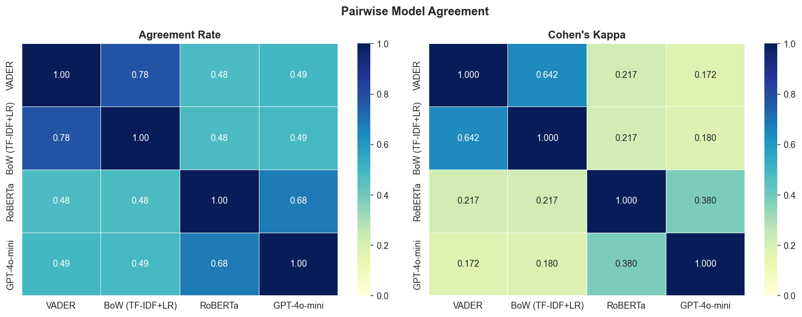
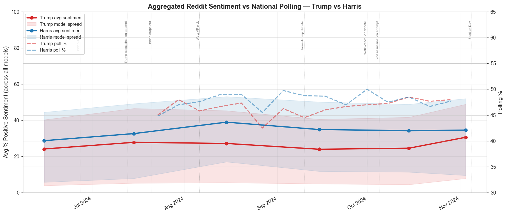

# Reddit Sentiment in the 2024 US Election

Measuring sentiment toward Trump and Harris in **6.6 million r/politics comments** (June – November 2024) with three generations of NLP: a bag-of-words classifier, a transformer (RoBERTa) and an LLM (GPT-4o-mini). We also test whether Reddit sentiment tracks national polls.



## Results

Evaluated on a 12,000-comment basis (2,000 candidate-mentioning comments per month), with VADER as silver labels:

| Model | Accuracy vs VADER | Macro F1 | Agreement with RoBERTa | Agreement with GPT-4o-mini |
|---|---:|---:|---:|---:|
| TF-IDF + Logistic Regression | 77.8% | 0.761 | 47.8% | 49.0% |
| RoBERTa (`twitter-roberta-base-sentiment-latest`) | 47.8% | 0.409 | – | **68.3%** (κ = 0.38) |
| GPT-4o-mini (6-shot) | 49.4% | 0.425 | **68.3%** | – |

## Key findings

1. **The labels are the bottleneck, not the models.** The bag-of-words model scores highest only because it was trained on VADER's labels and learns to imitate them. RoBERTa and GPT-4o-mini agree with each other far more (68%) than either agrees with VADER (about 48%). The two context-aware models largely agree with each other, and the lexicon labels do not.
2. **VADER misreads political sarcasm.** Positive words in hostile comments ("Found proof that Trump's pee tape is real!") get labelled positive. Of the comments VADER calls positive, RoBERTa labels only 14% positive and GPT-4o-mini 26%; both see r/politics as much more negative.
3. **Reddit is not a poll.** The monthly correlations between sentiment and polling (16 model × candidate × metric combinations) range from r = 0.07 to 0.58, and none is significant (all p > 0.3). With only 5 monthly points (Jul – Nov) and a heavily left-leaning subreddit, Reddit sentiment does not track national opinion.
4. **No candidate bias in the classifiers.** Each model's accuracy differs by less than 1.5 percentage points between Trump and Harris comments.



## Pipeline

| Step | Notebook | What it does |
|---|---|---|
| 1 | [`Combine_Monthly_Data`](Notebooks/Combine_Monthly_Data.ipynb) | Merges each month's base and supplement JSONL files and deduplicates by ID |
| 2 | [`Data_preparation`](Notebooks/Data_preparation.ipynb) | Keyword filter for election posts (about 62k), joins comments to posts through `link_id`, removes bots → 6.6M comments in Parquet |
| 3 | [`VADER_Labeling`](Notebooks/VADER_Labeling.ipynb) | Labels all 6.6M comments with VADER (±0.05 compound thresholds) |
| 4 | [`EDA`](Notebooks/EDA.ipynb) | Volume, thread structure, text characteristics, candidate framing, label distribution |
| 5 | [`Models`](Notebooks/Models.ipynb) | Trains BoW on a stratified 80k sample, runs RoBERTa and GPT-4o-mini on the 12k basis, compares metrics, κ and disagreements |
| 6 | [`Sentiment_Analysis`](Notebooks/Sentiment_Analysis.ipynb) | Sentiment over time, net sentiment, candidate gap, event windows, correlation with 55 national polls |

Expensive steps save checkpoints (GPT calls every 500 rows), so a run can be stopped and resumed without paying twice.

## How to run

```bash
pip install -r requirements.txt
```

1. **Data:** download all r/politics posts and comments for 1 Jun – 8 Nov 2024 from [Arctic Shift](https://arctic-shift.photon-reddit.com/download-tool) as JSONL, name them as `Combine_Monthly_Data` expects (`r_politics_posts_<Month>.jsonl`, `r_politics_comments_<Month>.jsonl`) and put them in a `Datasources/` folder at the repo root. Raw Reddit data is not redistributed here.
2. **Polls:** step 6 reads `Datasources/2024_Election_Polls.xlsx` (not included): 55 national polls taken from Wikipedia's [2024 nationwide opinion polling](https://en.wikipedia.org/wiki/Nationwide_opinion_polling_for_the_2024_United_States_presidential_election) page (Jul – Nov 2024).
3. **OpenAI key** (step 5 only): set the `OPENAI_API_KEY` environment variable.
4. Run the notebooks in the order above.

## Team

Group project for *Natural Language Processing*, MSc Business Administration & Data Science, Copenhagen Business School (2026).

- **Péter Szalay**: data pipeline, modelling and results
- **Connor Kennedy**: research framing and introduction, methodology (with Péter)
- **Gerry Kohn**: related work, data and EDA
- **Vincent Ballwieser**: data and EDA
